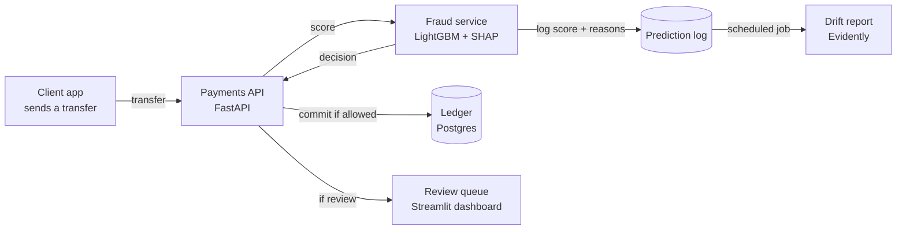

# Fraud Risk Engine

Scores every money transfer in real time and decides **allow**, **review** or **block**, with the top reasons behind each decision. Built on the PaySim dataset with an honest time-based evaluation, a served model, drift monitoring and a test of how a fraudster might evade it.

> Live demo: coming in week 5.

## Architecture



## Run it locally

### 1. Install

Windows (PowerShell):

```powershell
git clone https://github.com/agraciayyx/Fraud-Risk-Engine.git
cd Fraud-Risk-Engine
py -m venv .venv
.venv\Scripts\Activate.ps1
pip install -e ".[dev,notebook]"
pre-commit install
```

macOS or Linux:

```bash
git clone https://github.com/agraciayyx/Fraud-Risk-Engine.git
cd Fraud-Risk-Engine
python3 -m venv .venv
source .venv/bin/activate
pip install -e ".[dev,notebook]"
pre-commit install
```

### 2. Get the data

1. Download [PaySim](https://www.kaggle.com/datasets/ealaxi/paysim1) from Kaggle (free account needed).
2. Unzip the CSV into `data/raw/`.
3. Convert it to Parquet, which loads several times faster:

```bash
python -m app.data
```

### 3. Run the checks

```bash
ruff check .
ruff format --check .
mypy
pytest
```

### 4. Run the API

```bash
uvicorn app.main:app --reload
```

Or with Docker (copy `.env.example` to `.env` first):

```bash
docker compose up --build
```

Then open http://localhost:8000/health or the docs at http://localhost:8000/docs.

## Project layout

```
app/          service code (data loading, features, model, API)
tests/        unit and integration tests
notebooks/    exploration, kept separate from production code
data/         dataset files (not committed)
```

## Progress

- [ ] Week 1: time-based split, baseline model, PR-AUC reported
- [ ] Week 2: velocity features, LightGBM, thresholds chosen
- [ ] Week 3: SHAP reasons, model card, `/score` endpoint live
- [ ] Week 4: `/score` called before each transfer, review queue, drift report scheduled
- [ ] Week 5: hardening, evasion test, service deployed, write-up done
